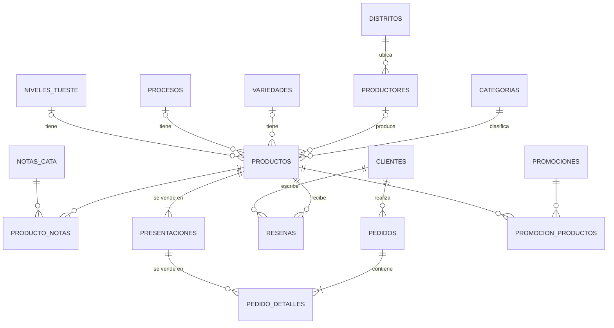

# ☕ Café Bella Durmiente · Tingo María

Tienda web de productos de café de **Tingo María (Leoncio Prado, Huánuco – Perú)**, con campaña navideña de panetones y un panel de administración.

## Cómo ejecutar

Requisito: **Node.js 22.13 o superior** (usa SQLite integrado en Node, no hay que instalar un servidor de base de datos).

```bash
npm install
npm start
```

- Tienda: http://localhost:3000
- Administración: http://localhost:3000/admin
  - Usuario: `admin` · Contraseña: `tingo2026` (**cámbiala** en *Mi cuenta*)

Para volver a los datos de ejemplo: `npm run reset-db` y luego `npm start`.

## Funcionalidades

**Tienda**
- Información breve sobre el café y sobre Tingo María (Bella Durmiente, Cueva de las Lechuzas, río Huallaga).
- Sección navideña con panetones, descuento vigente y cuenta regresiva a Navidad.
- Catálogo con filtros por categoría y buscador.
- Ficha de producto: origen, altitud, variedad, proceso, tueste, notas de cata y presentaciones con precio y stock.
- Reseñas con estrellas (quedan pendientes hasta que el administrador las aprueba).
- Carrito y registro de pedidos (pago contra entrega). Los precios se recalculan en el servidor.

**Administración**
- Resumen: ventas, pedidos y reseñas pendientes, stock bajo y productos más vendidos.
- Productos: crear, editar y eliminar, con imagen, presentaciones (precio y stock), notas de cata y destacado/visible.
- Reseñas: aprobar, ocultar, eliminar y agregar reseñas manualmente.
- Pedidos: ver el detalle, cambiar el estado (al cancelar se devuelve el stock) y contactar por WhatsApp.
- Promociones: descuentos por fechas aplicados a los productos elegidos.
- Catálogos: categorías, productores/fincas, distritos, variedades, procesos, tuestes y notas de cata.

## Estructura

```
server.js            Servidor Express
db/schema.sql        Esquema de la base de datos (tablas, restricciones y vistas)
db/seed.js           Datos de ejemplo
db/database.js       Conexión y consultas compartidas
routes/publico.js    API de la tienda
routes/admin.js      API del panel (requiere sesión)
lib/                 Validaciones y hash de contraseñas
public/              HTML, CSS y JS del frontend
uploads/             Imágenes subidas por el administrador
data/cafe.db         Archivo de la base de datos (se crea solo)
```

## Base de datos

### Modelo entidad-relación



### Normalización

| Forma normal | Cómo se cumple |
|---|---|
| **1FN** | Todos los valores son atómicos. Las notas de cata, presentaciones y productos en promoción **no** se guardan como listas en una celda: van en tablas propias (`producto_notas`, `presentaciones`, `promocion_productos`). |
| **2FN** | En las tablas con clave compuesta (`producto_notas`, `pedido_detalles`, `promocion_productos`), cada atributo depende de la clave completa. Por ejemplo, `cantidad` y `precio_unitario` dependen del par (pedido, presentación). |
| **3FN** | No hay dependencias transitivas. El nombre de la categoría, del distrito, de la variedad, etc. está en su tabla maestra y los productos guardan solo su `id`. El distrito y la altitud dependen del **productor**, no del producto. |
| **Datos derivados** | Los totales de pedidos, el promedio de estrellas y el descuento vigente **no se almacenan**: se calculan con las vistas `v_pedidos_resumen`, `v_rating_producto` y `v_descuento_vigente`. |

`pedido_detalles.precio_unitario` no es redundante: guarda el precio **pactado en la venta**, que es un dato histórico, porque el precio de la presentación puede cambiar después.

### Integridad
- Claves foráneas activas (`PRAGMA foreign_keys = ON`) con `RESTRICT`/`CASCADE` según el caso. Por ejemplo, no se puede borrar una variedad que usa algún producto.
- `CHECK`: precio > 0, stock ≥ 0, calificación 1–5, descuento 1–90 %, estados válidos y fechas coherentes.
- `UNIQUE`: nombres de catálogo, correo del cliente y una reseña por cliente y producto.
- Los pedidos se registran en **transacciones**: o se guarda todo (detalle y descuento de stock) o nada.
- Un producto con ventas no se borra: se desactiva para conservar el historial.

### Seguridad
- Contraseñas con hash **scrypt** y sal.
- Sesión con cookie `httpOnly`.
- Bloqueo de 5 minutos tras 5 intentos fallidos de inicio de sesión.
- Consultas parametrizadas (sin inyección SQL) y escape de HTML en el frontend.
- Imágenes validadas por tipo y limitadas a 3 MB.

> Los productores, clientes y reseñas de ejemplo son **ficticios**.
